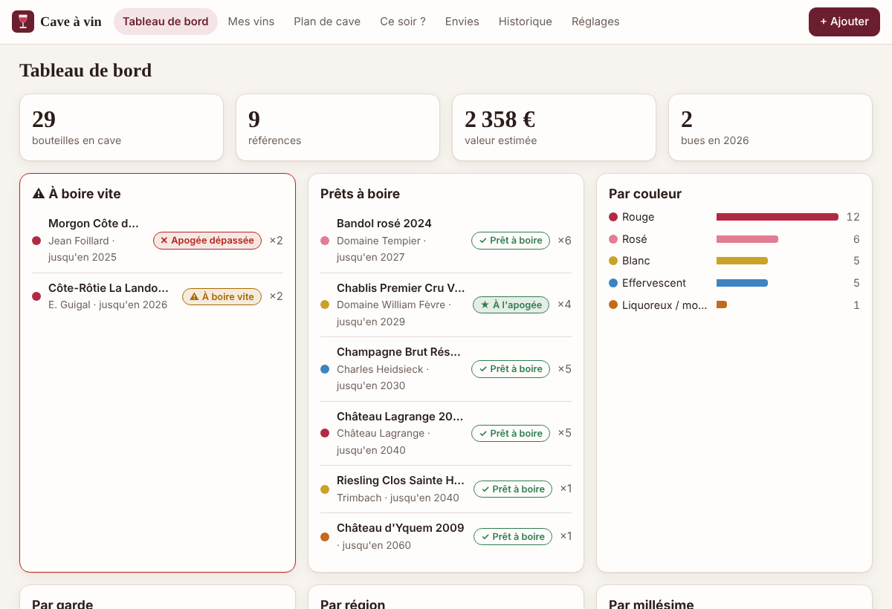
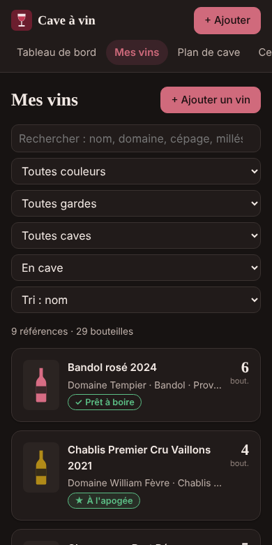
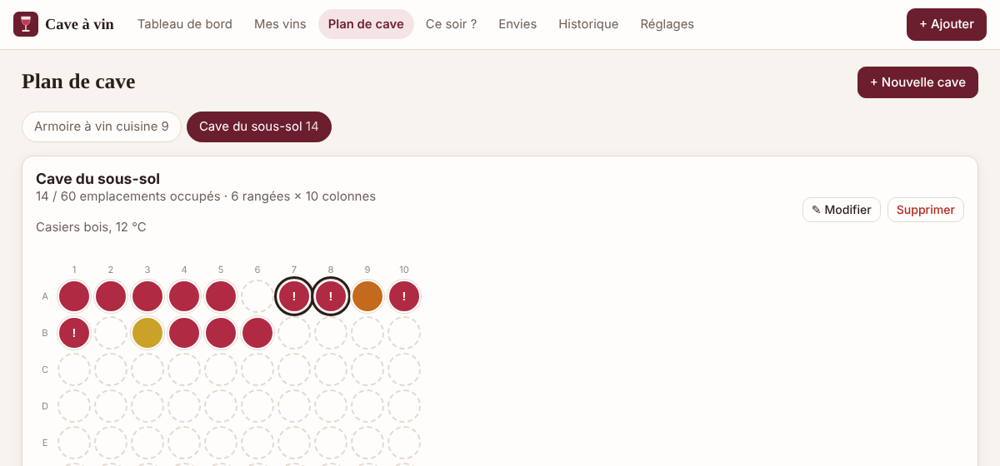
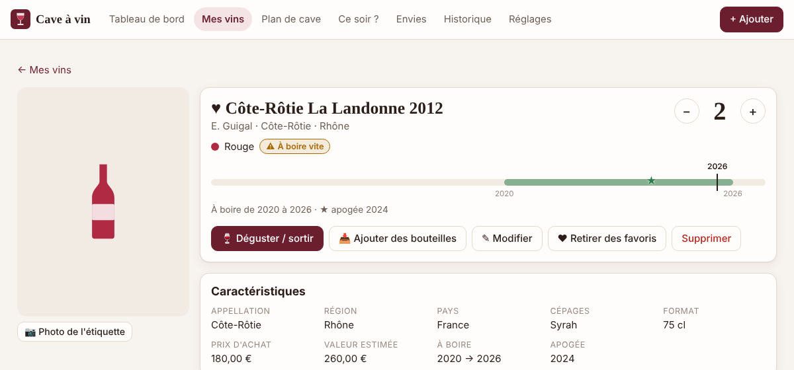

# Cave à vin 🍷

Un logiciel de gestion de cave à vin, dans l'esprit d'Oeni, **qui s'intègre à Home Assistant** : il s'ouvre dans la barre latérale de Home Assistant, lit la température et l'humidité de votre cave, et crée des capteurs, une liste d'envies et des actions utilisables dans vos automatisations ou avec Assist.

| Tableau de bord | Sur téléphone |
|---|---|
|  |  |

| Plan de cave | Fiche d'un vin |
|---|---|
|  |  |

Ce qu'il fait :

- **inventaire complet** : cuvée, domaine, appellation, région, couleur, millésime, cépages, format, prix d'achat, valeur estimée, fournisseur, accords, notes, **photo de l'étiquette** (prise directement avec le téléphone) ;
- **plan de cave visuel** : décrivez vos casiers ou votre armoire à vin (rangées × colonnes), chaque bouteille a sa case ; un clic pour la sortir ou la déplacer. Plusieurs caves possibles, et rangement « en vrac » pour les cartons ;
- **garde** : « à boire à partir de », « apogée », « à boire avant », avec **estimation automatique** selon la couleur, la région et le millésime. Les vins à boire vite sont signalés partout ;
- **dégustations** : chaque bouteille sortie peut recevoir une note sur 5 et un commentaire, conservés dans l'historique ;
- **« Que boire ce soir ? »** : choisissez le plat, la cave propose les meilleures bouteilles, en privilégiant celles à boire en priorité ;
- **statistiques** : bouteilles, valeur de la cave, répartition par couleur, région, millésime, garde et cave ;
- **liste d'envies** (vins à acheter), visible aussi dans Home Assistant ;
- **sauvegarde** : export CSV (Excel), sauvegarde complète JSON, import CSV ;
- fonctionne sur ordinateur, tablette et téléphone, en thème clair ou sombre ;
- **aucune dépendance** : uniquement Python, tourne sans souci sur un Raspberry Pi.

---

## Sommaire

1. [Installation dans Home Assistant (recommandé)](#1-installation-dans-home-assistant-recommandé)
2. [Ajouter l'intégration (capteurs, actions, envies)](#2-ajouter-lintégration-capteurs-actions-envies)
3. [Afficher la température de la cave](#3-afficher-la-température-de-la-cave)
4. [Premiers pas](#4-premiers-pas)
5. [Exemples d'automatisations et de tableau de bord](#5-exemples-dautomatisations-et-de-tableau-de-bord)
6. [Installation sans Home Assistant OS (Docker)](#6-installation-sans-home-assistant-os-docker)
7. [Import, export et sauvegardes](#7-import-export-et-sauvegardes)
8. [Pour les curieux : API et développement](#8-pour-les-curieux--api-et-développement)

---

## 1. Installation dans Home Assistant (recommandé)

Cette méthode demande **Home Assistant OS** ou **Supervised** (ceux qui ont le menu *Paramètres → Modules complémentaires*). Sinon, voir la [section 6](#6-installation-sans-home-assistant-os-docker).

### Méthode A : depuis un dépôt GitHub dédié

Si ce dossier `cave-a-vin` est publié comme dépôt GitHub à part entière (par exemple `https://github.com/Tessman404/cave-a-vin`) :

1. *Paramètres → Modules complémentaires → Boutique des modules complémentaires*.
2. Menu **⋮** en haut à droite → **Dépôts** → collez l'adresse du dépôt → **Ajouter**.
3. Cherchez **Cave à vin** dans la boutique → **Installer**.

### Méthode B : en module local (fonctionne tout de suite)

1. Installez le module **Samba share** ou **Advanced SSH & Web Terminal** pour accéder aux fichiers de Home Assistant.
2. Copiez le dossier **`cave_a_vin`** (celui qui contient `config.yaml`) dans le dossier **`addons`** de Home Assistant. Vous devez obtenir `addons/cave_a_vin/config.yaml`.
3. *Paramètres → Modules complémentaires → Boutique* → menu **⋮** → **Rechercher des mises à jour**.
4. **Cave à vin** apparaît dans la section **Modules complémentaires locaux** → **Installer** (la construction prend une à deux minutes sur un Raspberry Pi).

### Ensuite

1. Dans l'onglet **Info** du module, activez **Afficher dans la barre latérale** et **Démarrer au démarrage**, puis **Démarrer**.
2. L'entrée **Cave à vin** 🍷 apparaît dans la barre latérale : c'est votre cave, accessible aussi depuis l'application mobile Home Assistant, y compris hors de chez vous.

Vos données (base de données et photos) sont stockées dans le module et **incluses dans les sauvegardes Home Assistant**.

Onglet **Configuration** du module (facultatif) :

| Option | Rôle |
|---|---|
| **Clé d'API** | Protège l'accès direct à la cave (port 8099 et intégration). Le panneau dans Home Assistant n'est pas concerné. |
| **Réseau → 8099/tcp** | Renseignez `8099` pour ouvrir la cave directement sur `http://<ip-de-home-assistant>:8099` (inutile si vous passez par Home Assistant). |

---

## 2. Ajouter l'intégration (capteurs, actions, envies)

Le module complémentaire donne l'interface ; l'**intégration** donne les capteurs et les actions pour vos automatisations.

### Installation

- **Avec HACS** (si la cave est dans son propre dépôt GitHub) : *HACS → ⋮ → Dépôts personnalisés* → adresse du dépôt, catégorie **Intégration** → installez **Cave à vin**.
- **À la main** : copiez le dossier **`custom_components/cave_a_vin`** dans le dossier `config/custom_components/` de Home Assistant (créez `custom_components` s'il n'existe pas).

Puis **redémarrez Home Assistant**.

### Configuration

- **Avec le module complémentaire**, la cave est **détectée automatiquement** : une notification « Nouvel appareil détecté : Cave à vin » apparaît dans *Paramètres → Appareils et services*. Cliquez sur **Configurer**, c'est tout.
- Sinon : *Paramètres → Appareils et services → Ajouter une intégration → Cave à vin*, puis saisissez l'adresse :
  - module complémentaire : `http://<nom d'hôte>:8099`, le nom d'hôte étant indiqué dans l'onglet **Info** du module (par exemple `local-cave-a-vin`) ;
  - installation Docker : `http://<ip-de-la-machine>:8099`.
  - Si vous avez défini une clé d'API, saisissez-la aussi.

### Ce que vous obtenez

| Entité | Contenu |
|---|---|
| `sensor.cave_a_vin_bouteilles` | Nombre de bouteilles (attributs : par couleur, par cave, par garde) |
| `sensor.cave_a_vin_references` | Nombre de vins différents |
| `sensor.cave_a_vin_valeur_de_la_cave` | Valeur estimée en € |
| `sensor.cave_a_vin_pretes_a_boire` | Bouteilles dans leur fenêtre de garde (attribut `vins` : la liste) |
| `sensor.cave_a_vin_a_boire_vite` | Bouteilles en dernière année de garde ou dépassées (attribut `vins`) |
| `sensor.cave_a_vin_bues_cette_annee` | Bouteilles bues depuis le 1er janvier |
| `sensor.cave_a_vin_dernier_mouvement` | Dernière entrée/sortie (attributs : note, commentaire, date…) |
| un capteur par cave | Bouteilles dans chaque cave (attributs : capacité, places libres, taux de remplissage) |
| `todo.cave_a_vin_envies` | Votre liste d'envies, modifiable depuis Home Assistant et **avec Assist** : « Ajoute Meursault à Cave à vin Envies » |

Les noms exacts des entités dépendent de la langue de Home Assistant : vérifiez-les dans *Paramètres → Appareils et services → Cave à vin*.

| Action | Rôle |
|---|---|
| `cave_a_vin.sortir_bouteille` | Sort une ou plusieurs bouteilles d'un vin, avec note et commentaire |
| `cave_a_vin.ajouter_bouteilles` | Ajoute des bouteilles d'un vin déjà connu |
| `cave_a_vin.suggerer_vin` | Renvoie les meilleures bouteilles pour un plat (réponse utilisable dans un script) |
| `cave_a_vin.rechercher_vin` | Cherche un vin et renvoie son identifiant, son stock, sa garde |

---

## 3. Afficher la température de la cave

Si votre cave a un capteur de température et/ou d'humidité dans Home Assistant (Zigbee, Bluetooth, Wi-Fi…), la cave l'affiche sur son tableau de bord, avec une alerte s'il sort de la plage idéale.

1. Dans la cave : **Réglages → Home Assistant — capteurs de la cave**.
2. Choisissez vos capteurs dans les listes (avec le module complémentaire, la connexion est automatique).
3. Ajustez les plages idéales (par défaut 10–16 °C et 60–80 % d'humidité) → **Enregistrer**.

Sans le module complémentaire, renseignez aussi l'adresse de Home Assistant et un **jeton d'accès longue durée** (*Profil → Sécurité → Jetons d'accès longue durée → Créer un jeton*).

---

## 4. Premiers pas

1. **Plan de cave → + Nouvelle cave** : donnez un nom et le nombre de rangées et de colonnes de vos casiers (0 pour un rangement libre). Créez-en autant que vous avez d'emplacements (cave, armoire à vin, cellier…).
2. **+ Ajouter** : remplissez la fiche du vin. Le bouton **✨ Estimer** propose une fenêtre de garde ; corrigez-la si votre caviste vous a donné d'autres conseils. Indiquez le nombre de bouteilles et la cave : elles sont rangées automatiquement dans les premières cases libres.
3. Sur la fiche, **📷 Photo de l'étiquette** : sur téléphone, l'appareil photo s'ouvre directement.
4. Pour boire une bouteille : bouton **−** ou **🍷 Déguster / sortir** sur la fiche, ou clic sur sa case dans le plan. Ajoutez une note et vos impressions : elles restent dans l'historique, même si le vin n'est plus en cave.
5. Dans le plan, cliquez sur une **case vide** pour y ranger une bouteille non rangée, ou sur une bouteille puis **↔ Déplacer** pour changer sa place.

Astuce : sur téléphone, utilisez *Ajouter à l'écran d'accueil* depuis le navigateur pour avoir la cave comme une application.

---

## 5. Exemples d'automatisations et de tableau de bord

### Rappel hebdomadaire des bouteilles à boire vite

```yaml
automation:
  - alias: "Cave : bouteilles à boire vite"
    triggers:
      - trigger: time
        at: "18:00:00"
    conditions:
      - condition: time
        weekday: [fri]
      - condition: numeric_state
        entity_id: sensor.cave_a_vin_a_boire_vite
        above: 0
    actions:
      - action: notify.mobile_app_mon_telephone
        data:
          title: "🍷 À boire ce week-end"
          message: "{{ state_attr('sensor.cave_a_vin_a_boire_vite', 'vins') | join(', ') }}"
```

### Alerte de température de la cave

Elle se fait directement sur votre capteur (exemple : `sensor.cave_temperature`) :

```yaml
automation:
  - alias: "Cave : température anormale"
    triggers:
      - trigger: numeric_state
        entity_id: sensor.cave_temperature
        above: 18
        for: "01:00:00"
    actions:
      - action: notify.mobile_app_mon_telephone
        data:
          message: "La cave est à {{ states('sensor.cave_temperature') }} °C !"
```

### Script « Que boire ce soir ? » (utilisable avec Assist)

```yaml
script:
  vin_du_soir:
    alias: "Que boire ce soir ?"
    fields:
      plat:
        description: "viande_rouge, viande_blanche, poisson, fruits_de_mer, fromage, dessert, aperitif, epice, barbecue ou vegetarien"
    sequence:
      - action: cave_a_vin.suggerer_vin
        data:
          plat: "{{ plat | default('viande_rouge') }}"
          nombre: 3
        response_variable: cave
      - variables:
          resultat:
            texte: >-
              {{ s.nom }}{{ ' ' ~ s.millesime if s.millesime }}{{ ', ' if not loop.last }}
      - stop: ""
        response_variable: resultat
```

Exposez ce script à Assist (*Paramètres → Assistants vocaux → Exposer*) : avec un assistant conversationnel (LLM), « Quel vin pour l'agneau ce soir ? » suffit.

### Carte de tableau de bord

```yaml
type: vertical-stack
cards:
  - type: glance
    title: Cave à vin
    entities:
      - entity: sensor.cave_a_vin_bouteilles
        name: Bouteilles
      - entity: sensor.cave_a_vin_pretes_a_boire
        name: Prêtes
      - entity: sensor.cave_a_vin_a_boire_vite
        name: Vite !
      - entity: sensor.cave_temperature
        name: Temp.
  - type: markdown
    content: >-
      **À boire vite :** {{ state_attr('sensor.cave_a_vin_a_boire_vite', 'vins') | join(' · ') or 'rien d’urgent' }}
  - type: todo-list
    entity: todo.cave_a_vin_envies
```

---

## 6. Installation sans Home Assistant OS (Docker)

Pour Home Assistant « Container », un NAS ou un serveur :

```bash
cd cave-a-vin
docker compose up -d
```

La cave est alors sur `http://<ip-de-la-machine>:8099` et ses données dans le dossier `donnees/`. Les variables commentées dans `docker-compose.yml` permettent d'ajouter une clé d'API et la connexion à Home Assistant (aussi réglable depuis la page **Réglages**). Ajoutez ensuite l'intégration comme expliqué en [section 2](#2-ajouter-lintégration-capteurs-actions-envies).

Sans Docker, avec Python 3.11 ou plus récent :

```bash
cd cave-a-vin/cave_a_vin
python3 -m app            # données dans ./data, interface sur http://localhost:8099
```

Variables d'environnement : `CAVE_DATA_DIR` (dossier des données), `CAVE_PORT` (port, 8099 par défaut), `CAVE_API_KEY` (clé d'API), `HA_URL` et `HA_TOKEN` (connexion à Home Assistant).

> Si la cave est accessible depuis Internet sans passer par Home Assistant, **définissez une clé d'API**.

---

## 7. Import, export et sauvegardes

Dans **Réglages → Sauvegarde & import** :

- **Exporter en CSV** : un fichier qui s'ouvre dans Excel ou LibreOffice (séparateur `;`), une ligne par vin avec sa quantité ;
- **Sauvegarde complète (JSON)** : tout (caves, vins, emplacements, historique, envies), sauf les photos ;
- **Importer un CSV** : pour reprendre une cave tenue dans un tableur ou exportée d'une autre application. La première ligne doit contenir les noms de colonnes ; seule `nom` est obligatoire. Colonnes reconnues : `nom`, `domaine`, `appellation`, `region`, `pays`, `couleur` (`rouge`, `blanc`, `rose`, `effervescent`, `liquoreux`, `autre`), `millesime`, `cepages`, `format`, `degre`, `prix_achat`, `valeur`, `fournisseur`, `garde_debut`, `garde_apogee`, `garde_fin`, `accords`, `notes`, `favori`, `quantite`. Le plus simple : exportez d'abord un CSV pour voir le format, puis renommez les colonnes de votre fichier ;
- **Restaurer une sauvegarde JSON** : remplace toute la cave.

---

## 8. Pour les curieux : API et développement

Organisation :

```
cave-a-vin/
├── cave_a_vin/                 module complémentaire Home Assistant
│   ├── config.yaml, build.yaml, Dockerfile
│   ├── app/                    application (Python, bibliothèque standard uniquement)
│   │   ├── server.py           serveur HTTP et routes de l'API
│   │   ├── cave.py             logique : vins, bouteilles, garde, accords, stats
│   │   ├── db.py               base SQLite
│   │   ├── ha.py               lecture des capteurs Home Assistant
│   │   └── static/             interface web (HTML/CSS/JS, sans étape de compilation)
│   └── tests/                  tests de l'API
├── custom_components/cave_a_vin/   intégration Home Assistant
├── tests_ha/                   tests de l'intégration dans un vrai Home Assistant
├── repository.yaml, hacs.json  pour publier en dépôt de modules / HACS
└── docker-compose.yml
```

Principales routes (toutes en JSON, préfixe `api/`) :

| Route | Rôle |
|---|---|
| `GET vins?q=&couleur=&statut=&cave_id=&stock=1\|0\|all&tri=` | Liste et recherche |
| `POST vins` · `GET/PUT/DELETE vins/{id}` | Fiches des vins |
| `POST vins/{id}/entree` · `POST vins/{id}/sortie` | Ajouter / sortir des bouteilles |
| `PUT vins/{id}/photo` | Photo (data-URL JPEG/PNG/WebP) |
| `GET/POST caves` · `GET/PUT/DELETE caves/{id}` | Caves et plan |
| `PUT bouteilles/{id}` | Déplacer une bouteille |
| `GET suggestion?plat=&couleur=` | Accords |
| `GET stats` · `GET ha/resume` | Statistiques (le second est utilisé par l'intégration) |
| `GET export.csv` · `GET export.json` · `POST import.csv` · `POST import.json` | Sauvegardes |

Avec une clé d'API, ajoutez l'en-tête `X-API-Key: <clé>` (ou `Authorization: Bearer <clé>`).

Lancer les tests :

```bash
# API (aucune dépendance)
cd cave_a_vin && python3 -m unittest discover -s tests

# Intégration Home Assistant
pip install pytest-homeassistant-custom-component
python3 -m pytest -c tests_ha/pytest.ini --rootdir . tests_ha
```
